# Foddy — Restaurant QR Ordering & Delivery Platform

A cross-platform restaurant ordering system built with **Flutter** and **Supabase**. Diners scan a QR code on their table to order from their phone, delivery customers order from home, and the kitchen receives every order in real time on a live dashboard. One codebase runs on **Android, iOS and the web**.

**🔗 Live demo:** [foddy-app-b7a68.web.app](https://foddy-app-b7a68.web.app)


---

## Screenshots

### Mobile

| Home | Table menu | Item details |
|:---:|:---:|:---:|
| 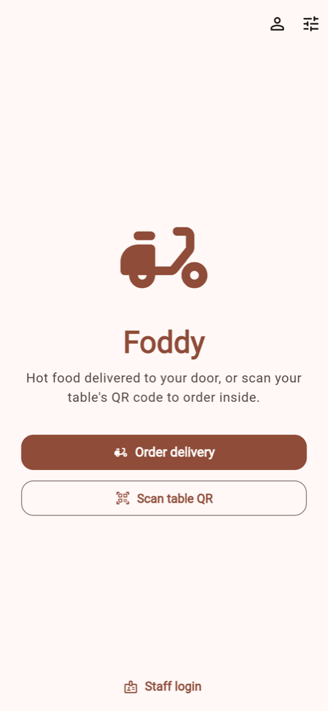 | 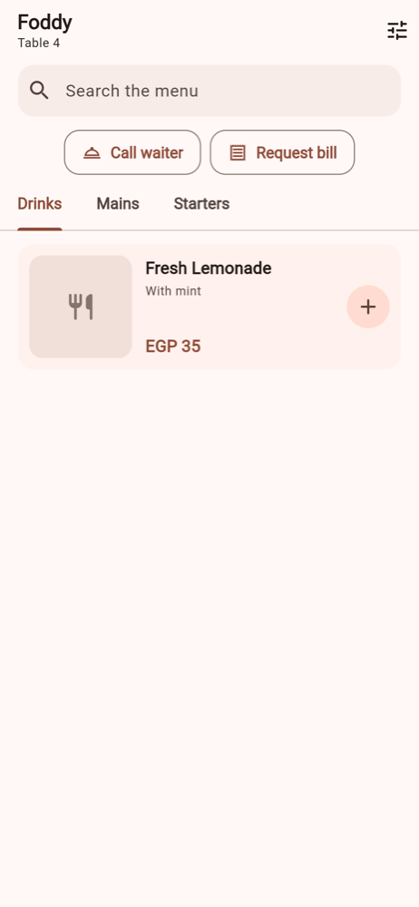 | 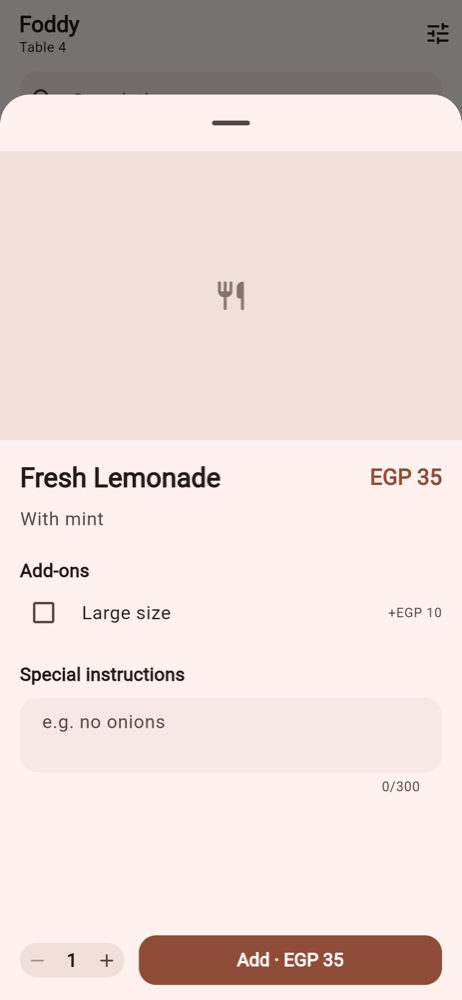 |

| Cart | Dark mode | Customer sign-in |
|:---:|:---:|:---:|
| 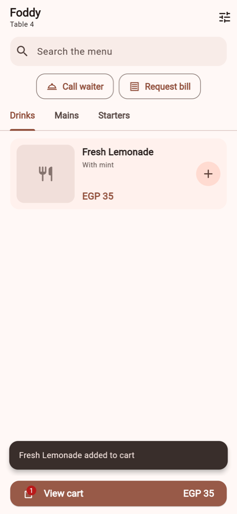 |  | 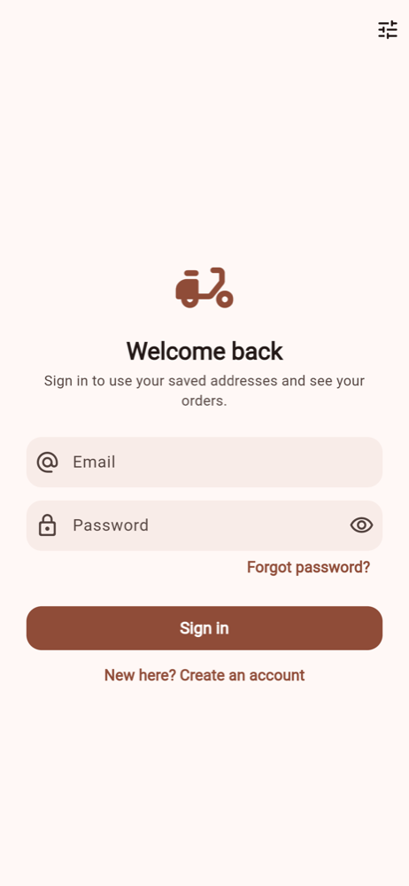 |

### Web

| Menu with side cart | Item details |
|:---:|:---:|
| 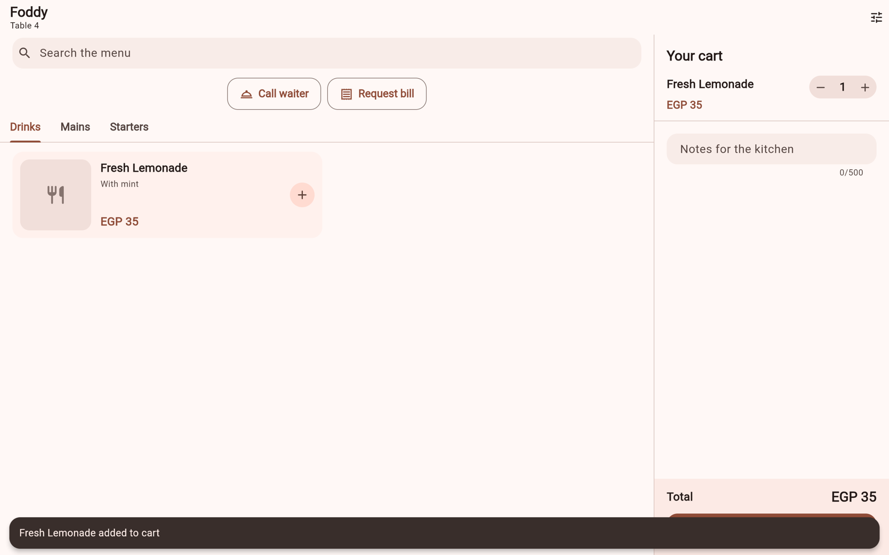 | 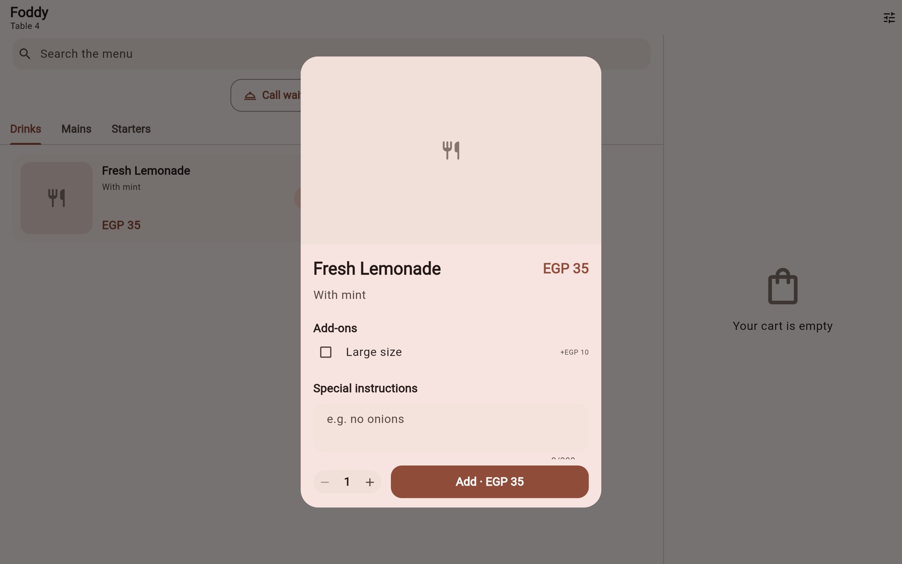 |

| Delivery menu | Home (dark mode) |
|:---:|:---:|
| 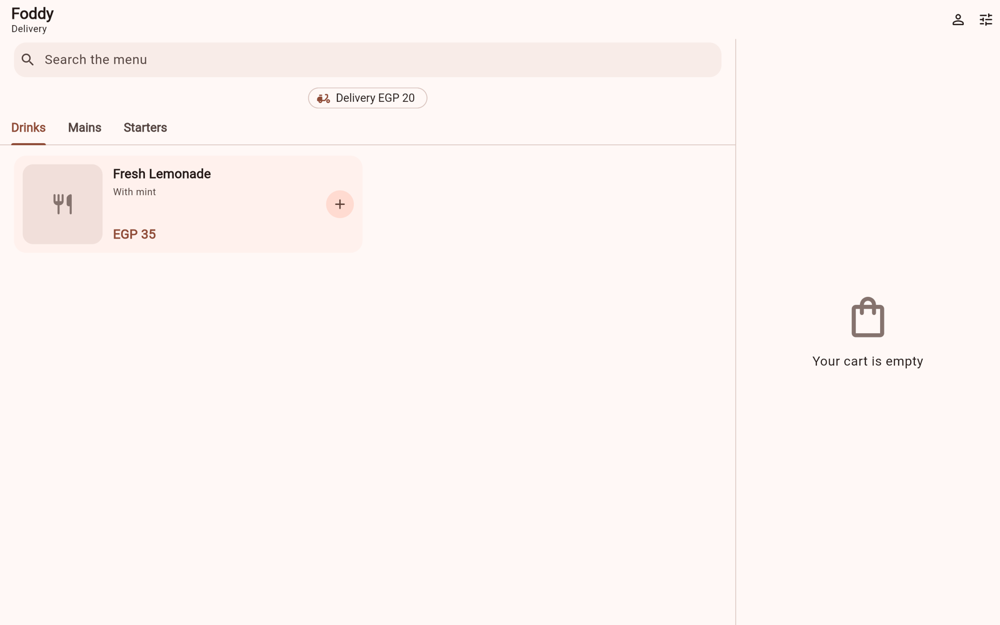 | 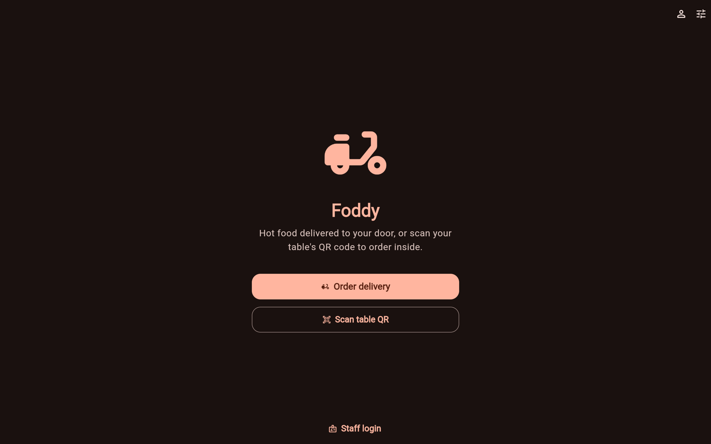 |

| Home | Staff sign-in |
|:---:|:---:|
| 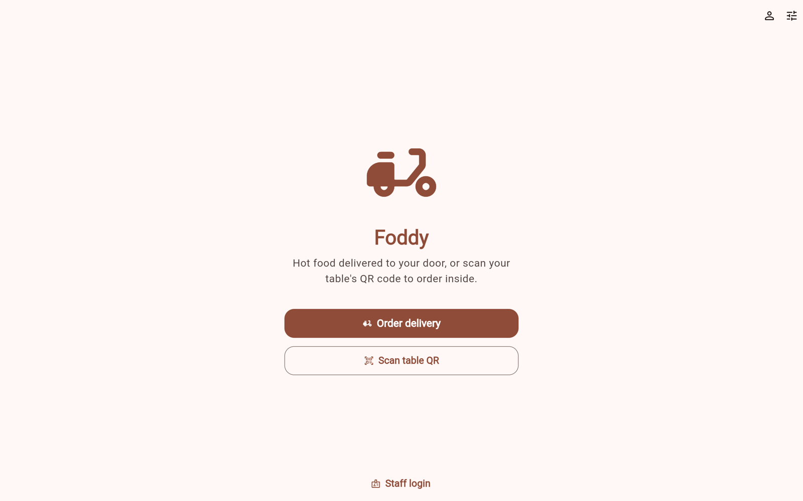 | 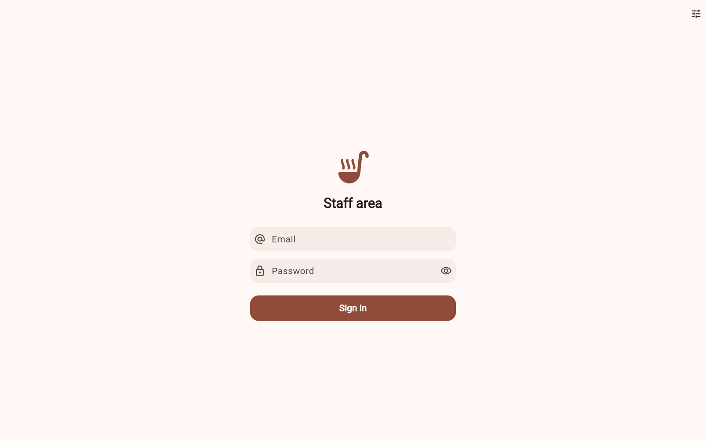 |

---

## Features

**For diners (dine-in)**
- Scan the table QR code → menu opens with the table already selected, no sign-up needed
- Search, categories, add-ons and special instructions per item
- Live order tracking: *Pending → Preparing → Ready → Served*, updated in real time
- One-tap **Call waiter** and **Request bill**

**For delivery customers**
- Delivery menu with fee and minimum order
- Guest checkout (name, phone, address) or an account with saved addresses and order history
- Email sign-up, confirmation and password reset with deep links back into the app

**For restaurant staff**
- **Kitchen board**: real-time Kanban of incoming orders with sound alerts and one-tap status changes
- **Admin dashboard**: manage menu items, categories and photos, tables and printable QR codes, staff roles, delivery settings, and daily sales statistics
- Role-based access: `admin`, `kitchen`, `waiter`

**Across the app**
- English and Arabic with full right-to-left layout
- Light and dark themes
- Responsive layouts for phone, tablet and desktop (1/2/3-column grids, side-panel cart, Kanban columns)

---

## Technical highlights

- **Clean Architecture** organised by feature (data / domain / presentation), with dependency injection via `get_it` + `injectable`
- **State management** with `flutter_bloc` (Blocs for event-heavy screens like the kitchen board, Cubits elsewhere)
- **Functional error handling**: every repository returns `Either<Failure, T>` (`dartz`); database errors are mapped to typed, localized failures
- **Real-time sync** on top of Supabase Realtime, with debounced re-fetching and automatic recovery after reconnects
- **Secure by design**: PostgreSQL Row Level Security on every table; orders can only be created through server-side functions that recalculate prices, so a modified client can't change totals
- **Invisible anonymous sessions** let diners order and track orders without an account, while still keeping each diner's orders private
- **Optimistic UI** for kitchen status changes, with rollback if the server rejects them
- **Deep links** for table QR codes (`/menu?restaurant=…&table=…`) on web, Android and iOS
- **80 automated tests**: unit, bloc and widget tests, including layout smoke tests at phone, tablet and desktop sizes in both English and Arabic (RTL)
- **Deployed** to Firebase Hosting (web) with signed Android release builds

## Tech stack

| Layer | Tools |
|---|---|
| App | Flutter, Dart, Material 3 |
| State & architecture | flutter_bloc, get_it, injectable, dartz, equatable |
| Navigation | go_router (path URLs, deep links, role-based guards) |
| Backend | Supabase: PostgreSQL, Auth, Realtime, Storage, PL/pgSQL functions |
| UI | flutter_screenutil, responsive breakpoints, RTL, light/dark themes |
| Other | mobile_scanner (QR scanning), qr_flutter + printing/pdf (printable QR codes), audioplayers |
| Testing | flutter_test, bloc_test, mocktail |
| Deployment | Firebase Hosting, Android App Bundle |

## Architecture

```
lib/
├── core/            # DI, routing, theme, localization, network, errors, shared widgets
└── features/
    ├── menu/        # restaurant, categories, items, search, QR scan
    ├── cart/        # cart state and persistence
    ├── orders/      # place order, live tracking, waiter/bill requests
    ├── account/     # customer accounts, addresses, delivery checkout
    ├── kitchen/     # real-time order board
    ├── auth/        # staff sign-in and roles
    └── admin/       # menu, tables, QR codes, staff, stats
        ├── data/          # Supabase data sources, models, repositories
        ├── domain/        # entities, repository contracts, use cases
        └── presentation/  # blocs/cubits, pages, widgets
```

---

*The source code is in a private repository and is available on request.*
